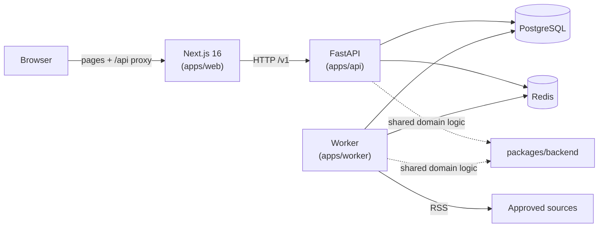

<p align="center">
  
</p>

<h1 align="center">RiftHub</h1>

<p align="center">
  <strong>Community-ranked discovery and discussion for Africa's tech ecosystem.</strong>
</p>

<p align="center">
  
  <a href="https://github.com/Bh3ky/the-beacon/commits/main"></a>
  <a href="LICENSE"></a>
</p>

<p align="center">
  
  
  
  
  
  
  
  
  
</p>


## Overview

RiftHub is a Hacker News-style community site focused on African technology: startups, funding, engineering, policy, and jobs. Members submit stories, vote, and discuss in threaded comments. A background worker also ingests stories from approved RSS sources.

It is a full-stack portfolio project covering authentication, ranking, moderation, background jobs, and a production-minded API. It is **pre-production**: the core loop works end to end, and the remaining gaps are listed honestly under [Known limitations](#known-limitations).

```text
discover  ->  vote  ->  discuss  ->  submit
```

## Features

| Area | What is built |
|---|---|
| **Accounts** | Registration, email verification, login and logout, cookie sessions, CSRF protection, resend-verification flow |
| **Posts** | Link, text (Ask) and job posts across 9 categories; URL normalization and duplicate-link detection; jobs expire after 30 days |
| **Feeds** | Top, New, Ask, Show and Jobs feeds with cursor pagination |
| **Voting** | Up and down votes on posts and comments, undo, self-vote protection, atomic counters |
| **Discussion** | Threaded comments (replies nest 6 levels below the top comment), sortable by top, new or old |
| **Ranking** | Time-decayed "hot" score with comment, category and domain-trust factors, refreshed every minute by the worker |
| **Moderation** | Flagging, moderator and admin roles, flag queue, remove posts and comments, suspend or ban users, audit trail of actions |
| **Ingestion** | RSS polling from approved sources, normalization, de-duplication, auto-publish or moderator review queue, source health view |
| **Platform stats** | Homepage activity strip (new members, funding stories, posts per hour, comments, live jobs) |

## Architecture



- **The browser only talks to Next.js.** Server-rendered pages call the API directly, and browser mutations go through a same-origin `/api` proxy, so session cookies and CSRF tokens stay on one origin.
- **Domain logic lives in `packages/backend`**, shared by the API and the worker. Route handlers stay thin.
- **The worker** is a small custom async scheduler with Redis-backed locks, so duplicate runs are skipped when more than one worker is running.

| Worker job | Interval |
|---|---|
| Poll RSS sources | 5 minutes |
| Refresh post ranking scores | 1 minute |
| Refresh feed snapshots (written to Redis; the API does not read them yet) | 1 minute |
| Reconcile vote counts | 1 hour |
| Expire job posts | 1 hour |

## Tech stack

| Layer | Technology |
|---|---|
| Frontend | Next.js 16 (App Router), React 19, TypeScript, Tailwind CSS 4 |
| API | FastAPI, Pydantic 2, SQLAlchemy 2 (async), Alembic |
| Database | PostgreSQL 17 via asyncpg |
| Cache and locks | Redis 7 (rate limiting and worker locks) |
| Worker | Python asyncio scheduler, aiohttp and feedparser for ingestion |
| Tooling | uv workspaces, npm workspaces, pytest, Ruff, Docker Compose |

## Security

| Concern | Approach |
|---|---|
| Passwords | PBKDF2-HMAC-SHA256, 600,000 iterations, per-password salt |
| Sessions | Opaque tokens stored hashed; `HttpOnly`, `Secure` (outside dev) and `SameSite=Lax` cookies; idle and absolute expiry |
| CSRF | Per-session HMAC token checked on every authenticated write, plus `Origin` validation |
| Rate limiting | Login, registration and verification limited per IP and per email; posting, commenting, voting and flagging limited per user. In-memory in development, Redis in production |
| Input limits | Length limits on titles, bodies, comments and flag notes; invalid input returns a structured `422` |
| Roles | `user`, `moderator`, `admin`, enforced server-side on every moderation route |
| Config | In production the API refuses to start unless secrets, HTTPS origins and email delivery are configured |

## Getting started

**Prerequisites:** Node.js 22+, npm 11+, Python 3.12+, [uv](https://docs.astral.sh/uv/), and Docker (for local Postgres and Redis).

```bash
git clone https://github.com/Bh3ky/the-beacon.git rifthub
cd rifthub

# 1. Dependencies
npm install
uv sync --all-packages

# 2. Environment (the defaults work for local development)
cp .env.example .env

# 3. Postgres and Redis
npm run db:up

# 4. Database schema and starter data
npm run db:upgrade
npm run db:seed:sources
npm run db:seed:feed
```

Run each of these in its own terminal:

```bash
npm run api:dev      # API    -> http://127.0.0.1:8000  (docs at /docs)
npm run web:dev      # Web    -> http://127.0.0.1:3000
npm run worker:dev   # Worker (optional: ranking, snapshots, RSS polling)
```

For the worker's locks and feed snapshots, set `RIFTHUB_REDIS_URL=redis://127.0.0.1:6379/0` in `.env`.

**Email in development.** Verification emails are not sent. The API prints the verification link in its terminal output; open it to verify the account.

**Create an admin.** Register an account, then promote it:

```bash
npm run db:set-role -- --email you@example.com --role admin
```

The full command reference is in [COMMANDS.md](COMMANDS.md).

## Testing and code quality

```bash
npm run api:test      # API tests (pytest)
uv run --package rifthub-worker pytest apps/worker/tests
npm run lint:py       # Ruff
cd apps/web && npm test                      # frontend unit tests
cd apps/web && ../../node_modules/.bin/tsc --noEmit
```

The Python suites (200+ API tests, 13 worker tests) run against fakes and do not need a database. There are no tests against a real PostgreSQL yet, and no browser or end-to-end tests.

## Project structure

| Path | Purpose |
|---|---|
| `apps/web` | Next.js frontend and the same-origin API proxy |
| `apps/api` | FastAPI app: routes, schemas, rate limiting, Alembic migrations |
| `apps/worker` | Background scheduler and jobs |
| `packages/backend` | Shared domain logic: auth, voting, ranking, moderation, ingestion, models |
| `scripts` | Seed data and admin helpers |
| `docs` | Design and planning documents |

## Documentation

| Document | Contents |
|---|---|
| [docs/API_SPEC.md](docs/API_SPEC.md) | API design, with a table of the routes that exist today |
| [docs/ARCHITECTURE.md](docs/ARCHITECTURE.md) | System design and service boundaries |
| [docs/DATABASE_SCHEMA.md](docs/DATABASE_SCHEMA.md) | Tables, constraints and indexes |
| [docs/RANKING_SYSTEM.md](docs/RANKING_SYSTEM.md) | How the hot score is computed |
| [docs/SECURITY.md](docs/SECURITY.md) | Security model |
| [docs/MODERATION_POLICY.md](docs/MODERATION_POLICY.md) | Moderation rules and roles |
| [docs/INGESTION_PIPELINE.md](docs/INGESTION_PIPELINE.md) | RSS ingestion design |
| [docs/PORTFOLIO_LAUNCH_CHECKLIST.md](docs/PORTFOLIO_LAUNCH_CHECKLIST.md) | Launch checklist and status |

Some design documents describe planned features. Where the code differs, the docs are marked "not implemented yet".

## Known limitations

- No post or comment editing or deletion by authors.
- No password reset, public user profiles, search, or topic tag pages.
- No new-account throttling or automated vote-manipulation detection.
- Link reposts are blocked for as long as the original post is active; there is no repost window.
- No real-database or end-to-end tests, and no CI pipeline yet.
- No deployment configuration (Dockerfiles, hosting) in this repository yet.

## Roadmap

| Item | Status |
|---|---|
| Post and comment editing | Planned |
| Password reset | Planned |
| User profiles | Planned |
| Search | Planned |
| CI and integration tests against PostgreSQL | Planned |
| Deployment guide and hosted demo | Planned |

## License

Released under the [MIT License](LICENSE). Copyright (c) 2026 RiftHub Inc.
